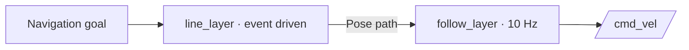

# 4. Assemble a control pipeline

After choosing the Map and Planners and implementing the WorldViews, the application only needs to
load the plugin package, create control layers based on the WorldViews, and define how the layers connect in sequence.

## Example application

The following excerpt from `finenav_example/getting_started/hello_finenav.cpp` shows how to assemble the pipeline:

```cpp
using namespace finenav;

auto node = rclcpp::Node::make_shared("hello_finenav");
auto engine = std::make_shared<finenav::FineNavEngine>(node);

engine->loadAlgoPlugins({"finenav_example"});

engine->createControlLayer(
    "dummy_line_world_view",
    "line_layer",
    core::EventDrivenPolicy{});

engine->createControlLayer(
    "dummy_follow_world_view",
    "follow_layer",
    core::PeriodicPolicy{10.0});

engine->registerControlBranch(
    "navigate",
    {"line_layer", "follow_layer"});
```

## Data flow



| Call | What it configures |
| --- | --- |
| `loadAlgoPlugins({"finenav_example"})` | Discovers the installed Map, Planner, and WorldView libraries in the package. |
| `createControlLayer(..., "line_layer", EventDrivenPolicy{})` | Generates a path when a new upstream reference arrives. |
| `createControlLayer(..., "follow_layer", PeriodicPolicy{10.0})` | Follows the latest path using current robot state at a target 10 Hz. |
| `registerControlBranch("navigate", {"line_layer", "follow_layer"})` | Connects the layers in that order under branch name `navigate`. |

The first layer receives the navigation goal; the second receives the first
layer's pose path.

These assembly methods return `bool`. The minimal example omits error handling;
in your application, you can check their return values to stop initialization on failure.

## Parameter configuration

`hello_finenav.launch.py` loads `hello_finenav.yaml`. The following excerpt contains the pipeline-related parameters:

```yaml
/hello_finenav:
  ros__parameters:
    use_sim_time: true  # Use simulation time from /clock.

/hello_finenav/finenav_localizer:
  ros__parameters:
    pose_topic: ""  # Absolute-pose input topic; empty disables this input.
    pose_smoothing_time: 0.0  # Pose-correction smoothing time (s); 0 applies corrections immediately.
    initial_pose_topic: ""  # One-shot initial-pose input topic; an empty string disables this input.
    twist_topic: ""  # Body-frame velocity input topic; empty disables this input.

    odom_topic: "/odom"  # Odometry input topic used to update the robot pose.
    odom_use_twist: true  # Also use the input odometry's twist to update robot velocity.

    state_history_duration: 5.0  # Robot-state history duration (s) for timestamped queries.

    force_2d_mode: true  # Whether to use 2D mode, constraining pose z, roll, and pitch to zero.
    publish_tf: false  # Whether to broadcast the world-to-robot TF.
    publish_odom: true  # Publish the estimated state as Odometry on ~/nav_state.

/hello_finenav/dummy_map:
  ros__parameters:
    dummy_map:
      window_size: 50.0  # Map window half-extent parameter (m); bounds are fixed in this example.

/hello_finenav/line_layer:
  ros__parameters:
    dummy_line_planner:
      path_resolution: 0.2  # Spacing between generated straight-line path samples (m).

/hello_finenav/follow_layer:
  ros__parameters:
    dummy_follow_planner:
      linear_speed: 0.5  # Nominal forward speed (m/s); reduced as the heading error grows.
      angular_speed: 1.0  # Gain that converts heading error into angular velocity.
      lookahead_distance: 1.0  # Distance along the path used to select the tracking target (m).
```

`/hello_finenav/line_layer` and `/hello_finenav/follow_layer` come from the control-layer
names registered in `hello_finenav.cpp`; `dummy_line_planner` and `dummy_follow_planner` are the parameter
namespaces. If you change a control-layer name, update the corresponding YAML node path too.
The localizer reads `/odom`, while the default chassis interface publishes
`geometry_msgs/msg/Twist` on `/cmd_vel`.

You can adjust the relevant parameters dynamically at runtime. For example, to change
the nominal path-tracking speed used by `DummyFollowPlanner`, set `linear_speed` to `0.3` metres per second:

```bash
ros2 param set /hello_finenav/follow_layer dummy_follow_planner.linear_speed 0.3
```

The pipeline performs path planning and tracking in the order defined by the connected control layers, producing chassis motion commands. The Behavior Tree selects and starts control branches, checks whether the task is complete, and handles failures during execution.
For Behavior Tree configuration and usage, continue to [5. Configure a Behavior Tree](behavior-tree.md).

Refer to the following files for the complete example and API definitions:

- [Application entry point (hello_finenav.cpp)](https://github.com/FineNav/FineNav-Engine/blob/main/finenav_example/getting_started/hello_finenav.cpp): the complete code for Engine initialization, plugin loading, control-layer creation, and branch registration.
- [Runtime configuration (hello_finenav.yaml)](https://github.com/FineNav/FineNav-Engine/blob/main/finenav_example/config/hello_finenav.yaml): the full parameters loaded at launch, including localizer, Map, and Planner settings.
- [Public API (finenav_engine.hpp)](https://github.com/FineNav/FineNav-Engine/blob/main/finenav_engine_cpp/include/finenav_engine_cpp/finenav_engine.hpp): parameter and return-value declarations for methods such as `loadAlgoPlugins()`, `createControlLayer()`, and `registerControlBranch()`.
