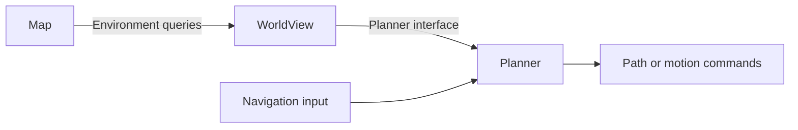

# Overview

FineNav-Engine is a ROS 2 tool for building robot navigation applications in C++.
It brings your environment representation and planning algorithms into one application,
with a common way to configure components, run planning, and submit navigation goals.

The typical workflow is to choose a Map and Planner, write a WorldView that connects
them, and assemble the navigation application through the C++ API.

## How the pieces fit together

| Component | Role in your application |
| --- | --- |
| **Map** | Represents the environment and exposes queries such as occupancy or terrain information. |
| **Planner** | Uses the robot state, navigation input, and environment queries to compute a path or motion commands. |
| **WorldView** | Presents the selected Map's information through the interface the Planner expects. |
| **FineNavEngine** | Loads your plugins, assembles the navigation components, and exposes goal and cancellation APIs. |

Your WorldView is where you decide how the Planner sees the environment.
For example, it can turn an occupancy query from a Map into the walkability query
required by a Planner, or derive a cost field before planning.

## Your workflow

1. [Choose a Map and Planner](guide/choose-algorithms.md) for your robot and environment.
2. [Write a WorldView](guide/worldview.md) to connect the Map to the Planner.
3. [Configure your C++ application](guide/cpp-application.md): load plugins, select the WorldView, and set navigation and localization parameters.
4. Run the application and send a goal from RViz or the C++ API.

FineNav-Engine provides component assembly and execution, ROS 2 integration,
parameter handling, and behavior-tree-based navigation.

## Start with components, extend when needed

Browse [FineNav Plugins](guide/plugins/index.md) to find Map and Planner components,
their capabilities, and repository links. Choose a suitable pair and connect
them through a WorldView.

When your application needs a different algorithm or environment representation,
you can write a [Custom Planner](guide/custom-planner.md) or
[Custom Map](guide/custom-map.md) and connect it through a WorldView.

Follow the [Quickstart](guide/quickstart.md) to build and run the included example.
