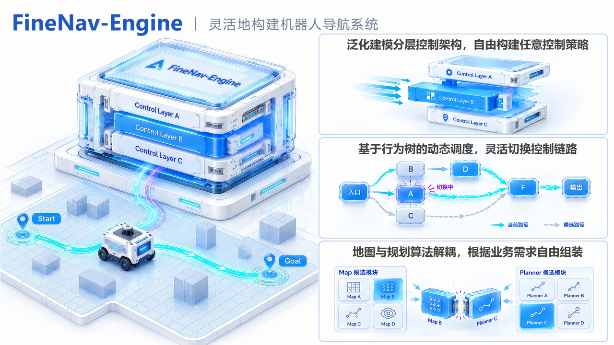
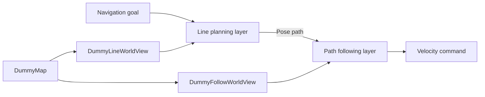

# FineNav-Engine

FineNav-Engine is a ROS 2 C++ tool for assembling navigation applications. Choose
Map and Planner components, connect them with a WorldView, assemble a control
pipeline, and use a Behavior Tree to define how a navigation task runs.

| Component | Configuration |
| --- | --- |
| Map | The environment representation and its data sources. |
| Planner | The algorithm for producing a path or motion commands. |
| WorldView | The adapter from a selected Map to a Planner's environment queries. |
| Control pipeline | The order of the planning layers and when each layer runs. |
| Behavior Tree | Task execution, completion conditions, stopping, and recovery. |

## Getting Started

The Getting Started tutorial follows `finenav_example` on `main`.
It covers running the example, selecting components,
writing a WorldView, and assembling a navigation workflow.

1. [Installation](guide/installation.md): prepare ROS 2, clone the repositories, and build.
2. [Run the example](guide/quickstart.md): start the simulator and send a goal.
3. [Choose Map and Planner](guide/choose-algorithms.md): understand the example's component choices.
4. [Write a WorldView](guide/worldview.md): adapt Map queries to a Planner's interface.
5. [Assemble a control pipeline](guide/cpp-application.md): connect the two layers in C++.
6. [Configure a Behavior Tree](guide/behavior-tree.md): adapt task behavior to your requirements.

The dummy components illustrate integration. `DummyMap` has no obstacle data,
and the follower does not implement final-heading alignment or terminal braking.

## Component catalogues

Browse [finenav_planner](guide/plugins/planners.md) and
[finenav_map](guide/plugins/maps.md) for the independent component repositories
and their current integration status. Each catalogue also links to custom
plugin development when an existing component does not meet your needs.
