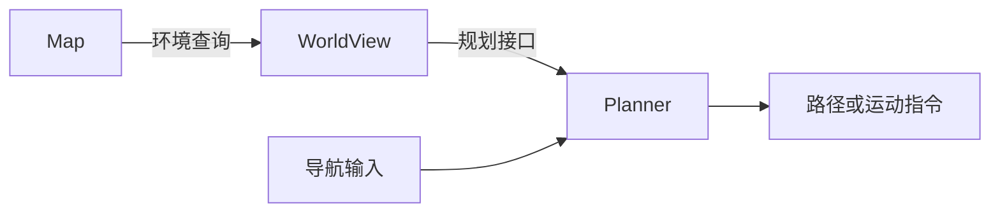

# 项目总览

FineNav-Engine 是用于在 C++ 中构建机器人导航应用的 ROS 2 工具。
它将环境表示与规划算法接入同一个应用，提供组件配置、规划执行和导航目标提交方式。

典型使用流程是：选择 Map 和 Planner，编写连接两者的 WorldView，
再通过 C++ API 配置导航应用。

## 组件如何配合

| 组件 | 在应用中的职责 |
| --- | --- |
| **Map** | 表示环境，提供占用状态、地形信息等查询。 |
| **Planner** | 根据机器人状态、导航输入和环境查询计算路径或运动指令。 |
| **WorldView** | 通过 Planner 所需的接口提供所选 Map 的信息。 |
| **FineNavEngine** | 加载插件、装配导航组件，并提供目标提交与取消接口。 |

WorldView 决定 Planner 如何使用环境信息。例如，可以将 Map 的占用查询转为
Planner 所需的可通行性查询，或在规划前生成代价场。

## 使用流程

1. 为机器人和环境[选择 Map 和 Planner](guide/choose-algorithms.md)。
2. [编写 WorldView](guide/worldview.md)，适配 Map 与 Planner。
3. [配置 C++ 应用](guide/cpp-application.md)：加载插件、选择 WorldView，设置导航与定位参数。
4. 运行应用，通过 RViz 或 C++ API 发送目标。

FineNav-Engine 提供组件装配与执行、ROS 2 集成、参数处理，以及基于行为树的导航。

## 先使用现有组件，再按需扩展

通过 [FineNav 插件](guide/plugins/index.md)查阅 Map 和 Planner 组件、能力与仓库链接，
选择适合的组合，并通过 WorldView 连接它们。

需要不同的算法或环境表示时，可以开发[自定义 Planner](guide/custom-planner.md)
或[自定义 Map](guide/custom-map.md)，再通过 WorldView 接入应用。

按照[快速开始](guide/quickstart.md)编译并运行仓库中的示例。

当前中文首页已提供；其余页面暂时回退到英文，后续可通过同名 `.zh.md` 文件补充翻译。
