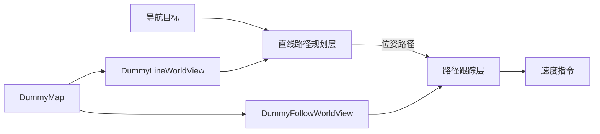

# FineNav-Engine

FineNav-Engine 是一个用于组装导航应用的 ROS 2 C++ 工具。选择 Map 和 Planner，
通过 WorldView 对接地图查询，在 C++ 中组装控制 pipeline，再通过行为树定义导航任务的执行方式。

| 组件 | 配置内容 |
| --- | --- |
| Map | 环境表示方式，以及地图的数据来源。 |
| Planner | 生成路径或运动指令的算法。 |
| WorldView | 将所选 Map 的查询转换成 Planner 需要的环境接口。 |
| 控制 pipeline | 各规划层的连接顺序和执行时机。 |
| Behavior Tree（行为树） | 任务执行、完成条件、停车和故障恢复。 |

## 入门教程

Getting Started 以 `main` 分支的 `finenav_example` 为基础。
教程涵盖示例运行、组件选择、WorldView 适配和导航流程组装。

1. [如何安装](guide/installation.md)：配置 ROS 2 环境、克隆仓库并编译。
2. [运行示例](guide/quickstart.md)：启动仿真并发送目标点。
3. [选择 Map 和 Planner](guide/choose-algorithms.md)：理解示例使用的组件组合。
4. [编写 WorldView](guide/worldview.md)：把地图查询适配到 Planner 接口。
5. [组装控制 Pipeline](guide/cpp-application.md)：通过 C++ 连接两个控制层。
6. [按需求配置行为树](guide/behavior-tree.md)：调整任务执行和完成方式。

Dummy 组件用于演示接入流程。`DummyMap` 不包含障碍物数据，示例跟踪器也未实现终点朝向对齐和到点减速。

## 组件目录

[finenav_planners](guide/plugins/planners.md) 和 [finenav_maps](guide/plugins/maps.md)
分别介绍独立的规划、地图组件仓库及当前接入状态。需要扩展算法时，可继续阅读栏目中的自定义插件指南。
