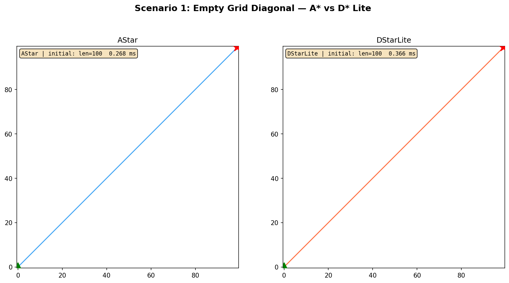
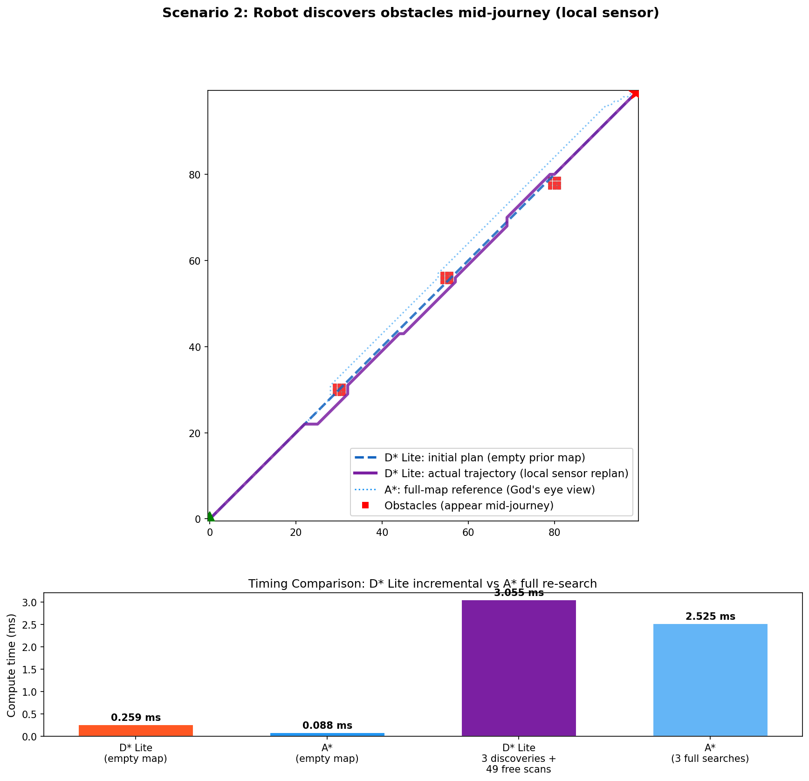
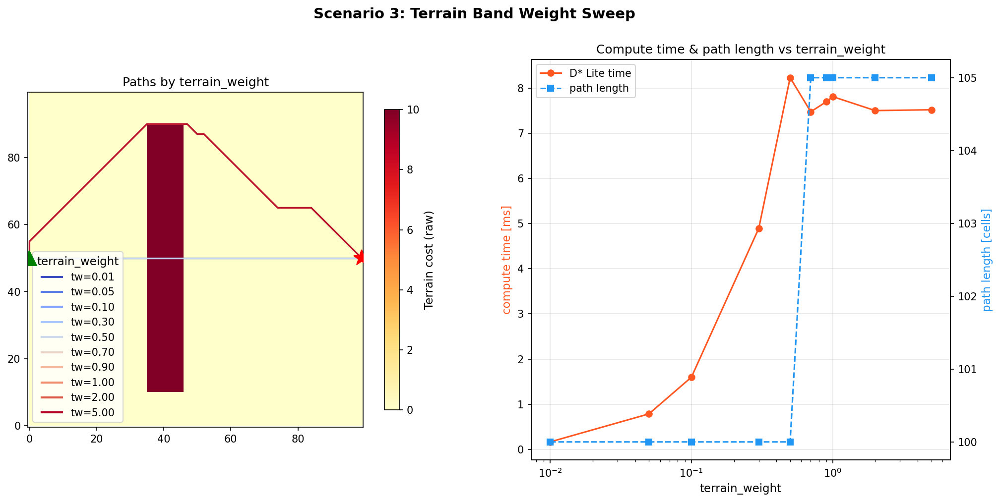
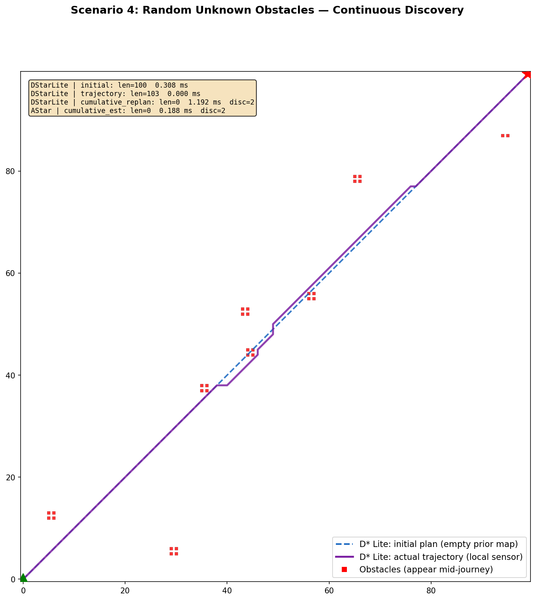

# finenav_route_planner

FineNav-Engine 全局路径规划器集合，包含四种互补的规划算法：**A\***、**BFS / Dijkstra**、**D\* Lite** 和**拓扑路网规划**。所有规划器均实现 `finenav::PlannerConcept` 接口，通过 `IMapView` 适配层与地图解耦。

## 四种规划器

| 规划器 | 算法 | 特点 | 适用场景 |
|--------|------|------|----------|
| `AstarPathSearch` | A\* 启发式搜索 | 单次规划、最优解 | 静态地图、一次性路径 |
| `BfsPathSearch` | BFS / Dijkstra | 无方向性、代价驱动 | 不需要启发式的纯代价搜索 |
| `DStarLitePathSearch` | D\* Lite 增量搜索 | 跨调用保持状态、增量修复 | 动态环境、传感器在线重规划 |
| `RoutePathSearch` | 图 Dijkstra + 栅格吸附 | GeoJSON 路网图、拓扑级规划 | 结构化路网（医院、园区） |

## 架构

```
                    ┌─────────────────────┐
                    │    PlannerConcept    │
                    └──────────┬──────────┘
           ┌───────────────────┼───────────────────┐
           │                   │                   │
   AstarPathSearch     BfsPathSearch       RoutePathSearch
           │                   │                   │
   ┌───────┴───────┐   ┌───────┴───────┐   ┌───────┴───────┐
   │ AStarAlgorithm │   │ AStarAlgorithm │   │ route::Graph   │
   │    (engine)    │   │  (h=0 engine)  │   │ route::Dijkstra │
   └───────────────┘   └───────────────┘   │ + A* 栅格吸附 │
                                           └───────────────┘
   DStarLitePathSearch
           │
   ┌───────┴───────────┐
   │ DStarLiteAlgorithm │
   │    (engine)        │
   └───────────────────┘
```

所有规划器共享 `common/` 目录下的通用组件：`Vec3` 坐标、`IMapView` 接口、`Heuristic` 启发函数枚举、`Connectivity` 邻域连通模式等。

---

## 1. AstarPathSearch — A\* 均匀栅格搜索

标准的 A\* 启发式图搜索。每次 `plan()` 从零开始，不跨调用保留状态。支持二维（N4/N8）和三维（N6/N18/N26）邻域连通。

### 参数（`astar.yaml`）

| 参数 | 类型 | 默认值 | 说明 |
|------|------|--------|------|
| `connectivity` | string | `"8"` | 邻域连通模式：`4`/`8`/`6`/`18`/`26` |
| `heuristic` | string | `"Euclidean"` | 启发函数：`Euclidean` / `Manhattan` / `Chebyshev` / `Diagonal` |
| `goal_tolerance` | double | 0.5 | 目标到达容差（米） |
| `max_iterations` | int | 1000000 | 最大扩展节点数（-1 = 不限） |
| `max_planning_time` | double | 5.0 | 最大规划时间（秒） |
| `movement_weight` | double | 1.0 | 移动代价权重 |
| `greedy_weight` | double | 1.001 | 启发式贪心权重（>1 → 加权 A\*，搜索更快的次优解） |
| `terrain_weight` | double | 1.0 | 地形代价乘数（边代价 = step × (movement_weight + terrain_weight × cost)） |

### IMapView 接口

```cpp
class IMapView {
    bool isWalkable(const Position3D& p) const;   // 是否可通行
    double getCost(const Position3D& p) const;     // 地形额外代价 (≥0)
    double getStepSize() const;                    // 栅格步长（米/格）
};
```

### 启发式函数

| 启发式 | 二维 | 三维 | 可采纳性 |
|--------|------|------|----------|
| `Zero` | h = 0（退化为 Dijkstra） | ✓ | ✓ |
| `Manhattan` | \|dx\| + \|dy\| | ✓ | N4 |
| `Euclidean` | √(dx²+dy²) | ✓ | N8（较保守） |
| `Chebyshev` | max(\|dx\|, \|dy\|) | ✓ | N8 |
| `Diagonal` | octile 距离 | ✓ | N8（推荐） |

---

## 2. BfsPathSearch — BFS / Dijkstra 搜索

内部复用 `astar::AStarAlgorithm` 并将启发式固定为 `Heuristic::Zero`。等价于 Dijkstra（加权栅格）或 BFS（均匀栅格）。无 `heuristic` 和 `greedy_weight` 参数。

### 参数（`bfs.yaml`）

与 A\* 一致但不含 `heuristic` 和 `greedy_weight` 字段，其余 `connectivity`、`goal_tolerance`、`max_iterations`、`max_planning_time`、`movement_weight`、`terrain_weight` 同 A\*。

### IMapView 接口

同 `finenav::IMapView`，与 A\* 共享。

---

## 3. DStarLitePathSearch — D\* Lite 增量搜索

有状态的增量启发式搜索算法。跨 `plan()` 调用维护 g 值、rhs 值、优先队列 U 和 km 偏移量。地图局部变化时仅重算受影响区域——重规划复杂度为 O(受影响区域) 而非 O(全局)。

支持两种地图同步模式：
- `syncMap()` — 全量扫描，重新初始化
- `syncMapAround(robot_pos, sensor_range)` — 局部传感器范围扫描

### 参数（`dstarlite.yaml`）

| 参数 | 类型 | 默认值 | 说明 |
|------|------|--------|------|
| `connectivity` | string | `"8"` | 同 A\* |
| `heuristic` | string | `"Diagonal"` | 启发式（推荐 Diagonal） |
| `goal_tolerance` | double | 0.5 | 同 A\* |
| `max_expansions` | int | 50000 | 单次 `computeShortestPath` 最大扩展数 |
| `max_path_steps` | int | 5000 | `extractPath` 最大步数（-1 = 不限） |
| `max_planning_time` | double | 5.0 | 同 A\* |
| `movement_weight` | double | 1.0 | 同 A\* |
| `greedy_weight` | double | 1.001 | 同 A\* |
| `terrain_weight` | double | 1.0 | 同 A\* |

### IMapView 接口（扩展版）

```cpp
class IMapView : public finenav::IMapView {
    int rows() const;      // 栅格行数
    int cols() const;      // 栅格列数
    int layers() const;    // 栅格层数（2D 为 1）
};
```

### 核心概念

- **g(s)**：节点 s 到目标的已知最短路径代价
- **rhs(s)**：一步前瞻代价 = min_{s'∈Succ(s)}(cost(s,s') + g(s'))
- **一致性**：g(s) = rhs(s) → 一致（已收敛）；g(s) > rhs(s) → 过一致（存在更短路径）；g(s) < rhs(s) → 欠一致（路径变差）
- **km**：启发式偏移量，补偿机器人移动造成的启发式变化

---

## 4. RoutePathSearch — 拓扑路网规划

混合规划器：基于 GeoJSON 路网图进行拓扑级 Dijkstra 搜索，利用 A\*（h=0）栅格搜索将机器人/目标位姿吸附（snap）到最近可达的路网点。

### 工作流程

1. 从 `/geojson` 话题（transient_local QoS）加载路网图
2. 过滤因障碍物被阻断的边（节点不可达时裁剪）
3. 用 A\* 栅格搜索将起点/目标吸附到最近路网点
4. 在路网图中插入虚拟节点、拆分被穿过的边
5. 在（可能已修改的）路网图上运行 Dijkstra
6. 按 `path_density` 对折线边插值加密

### 参数（`route.yaml`）

| 参数 | 类型 | 默认值 | 说明 |
|------|------|--------|------|
| `path_density` | double | 0.5 | 路径插值步长（米，≤0 则仅返回图节点） |
| `min_approach_angle_deg` | double | 30.0 | 边拆分时的最小接近角（度） |
| `goal_tolerance` | double | 0.5 | 目标到达容差（米） |
| `terrain_weight` | double | 1.0 | 栅格吸附阶段的 terrain_weight（同 A\* 公式） |

### IMapView 接口

同 `finenav::IMapView`，与 A\*/BFS 共享。

### GeoJSON 格式要求

路网图需为 FeatureCollection，包含：
- **Point** 要素：节点（需 `id` 属性）
- **LineString / MultiLineString** 要素：边（需 `startid`、`endid` 属性，可选 `cost`、`overridable`）

---

## 通用基础设施

### finenav::Connectivity 枚举

| 值 | 维度 | 邻居数 | 说明 |
|----|------|--------|------|
| `N4` | 2D | 4 | 上下左右 |
| `N8` | 2D | 8 | 含对角线 |
| `N6` | 3D | 6 | 面邻接 |
| `N18` | 3D | 18 | 面+边邻接 |
| `N26` | 3D | 26 | 面+边+角邻接 |

### 代价公式

所有栅格规划器统一使用：

```
edge_cost = step_cost × (movement_weight + terrain_weight × map_cost)
```

- `step_cost`：邻域步长（正交 = 1.0，对角 = √2，3D 对角 = √3）
- `movement_weight`：移动代价基础权重
- `terrain_weight`：地形代价乘数
- `map_cost`：地图层返回的额外代价

### terrain_weight 调参经验

| 代价尺度 | terrain_weight 推荐 |
|----------|---------------------|
| 归一化 0–1 | 1.3 ~ 3.5（典型 2.0） |
| OccupancyGrid 0–100 | ≈ 0.02 |
| Nav2 costmap 0–252 | ≈ 0.008 |

法则：`terrain_weight × 最高可通行代价 ≈ 2 × movement_weight`

---

## 编译与测试

```bash
cd ~/FineNav_ws
source /opt/ros/humble/setup.bash
colcon build --symlink-install --packages-select finenav_route_planner
colcon test --packages-select finenav_route_planner
```

- 70+ 单元测试（GTest），涵盖 A\*、BFS、Route、D\* Lite
- Google Benchmark 性能测试（`benchmark/route_planner_benchmark`）
- 独立评测（`eval/route_planner_eval`，无 ROS 依赖，输出 PNG 可视化）

---

## 独立评测

```bash
./build/finenav_route_planner/eval/route_planner_eval
# PNG 输出到 /tmp/dstarlite_eval/
# 也可用 eval/plot.py 单独绘图
```

四个评测场景，100×100 栅格，传感器范围 12 格，每 2 步扫描一次。

> **⚠️ 关于 D\* Lite vs A\* 的性能对比：** 以下数据基于 100×100 小栅格（仅 10,000 个节点），A\* 全图搜索不到 1ms 即可完成，D\* Lite 维护内部状态的固定开销反而更贵。**D\* Lite 的优势在大规模地图的增量重规划**——以下是 300×300 栅格（90,000 节点）的 Google Benchmark 实测数据：
>
> | 新增障碍物 | D\* Lite replan | A\* 全量重搜 | |
> |-----------|----------------|-------------|------|
> | 1 个 | **0.12 ms** | 8.76 ms | **D\* Lite 75× 更快** |
> | 11 个 | **3.42 ms** | 9.17 ms | **D\* Lite 2.7× 更快** |
> | 21 个 | 6.09 ms | 8.79 ms | 1.4× 更快 |
> | 31 个 | 10.3 ms | 8.84 ms | A\* 反超 |
>
> 少量局部变化时 D\* Lite 仅更新受影响区域，碾压全局重搜。随着变化区域扩大，增量优势递减——约 30 个障碍物时达到临界点。这体现了 D\* Lite 的适用边界：**地图越大、变化越局部，优势越明显。** 此外，场景 2/4 中 A\* 的 `cumulative_est` 为采样估算值，不作为精确对比依据。

### 场景 1：空图对角线（A\* vs D\* Lite 基准对比）

| 指标 | A\* | D\* Lite |
|------|-----|----------|
| 路径长度（格） | 100 | 100 |
| 计算时间 | 0.27 ms | 0.37 ms |

两者在静态空图上均给出完全一致的最优解。



### 场景 2：动态障碍物 + 局部传感器在线重规划 ★

核心场景：机器人从 (0,0) 走向 (99,99)，途中三个障碍物簇分别在步 20、45、70 **动态出现**。机器人仅通过 `syncMapAround(pos, sensor_range)` 感知 12 格范围内的变化。

**图例：** 蓝色虚线 = D\* Lite 初始规划（空图），紫色实线 = D\* Lite 实际轨迹（局部传感器 replan），蓝色点线 = A\* 上帝视角参照，红色方块 = 动态出现的障碍物。

| 阶段 | D\* Lite (增量) | A\* (全局重搜) |
|------|----------------|---------------|
| 初始规划 | 0.26 ms | — |
| 实际轨迹 | 105 步 | 104 步 |
| 累计重规划 | **3.05 ms** (3 次 replan) | 0.51 ms (3 次全局) |
| A\* 空图基线 | — | 0.09 ms |
| A\* 全图（含障碍物） | — | 0.84 ms |

D\* Lite 单次 replan 平均约 **1.0 ms**，A\* 每次从头搜索约 **0.17 ms**（但失去了增量更新的灵活性——地图变化时必须全量重搜）。



### 场景 3：terrain_weight 参数扫描

从左下到右上穿越一条高代价带（对角线区域 cost=100，其余 cost=0）。`terrain_weight` 从 0.01 扫描到 5.0，对比不同权重下路径是否绕行以及绕行程度。

| terrain_weight | D\* Lite 长度 | D\* Lite 耗时 | A\* 长度 | A\* 耗时 |
|---------------|-------------|-------------|--------|--------|
| 0.01 | 100 | 0.16 ms | 100 | 0.13 ms |
| 0.05 | 100 | 0.78 ms | 100 | 0.40 ms |
| 0.10 | 100 | 1.60 ms | 100 | 0.66 ms |
| 0.30 | 100 | 4.90 ms | 100 | 1.60 ms |
| 0.50 | 100 | 8.24 ms | **105** | 2.26 ms |
| 0.70 | 105 | 7.48 ms | 105 | 1.97 ms |
| ≥ 1.0 | 105 | ~7.6 ms | 105 | ~1.9 ms |

`terrain_weight ≥ 0.5` 时，两类算法都开始绕行高代价区域，路径变长但总代价更低。



### 场景 4：随机障碍物渐进发现

30 个随机障碍物沿对角线散布，只有当机器人接近到 sensor_range+5 范围内才"出现"。模拟真实场景中传感器逐步发现未知障碍物的过程。

| 阶段 | D\* Lite | A\* |
|------|----------|-----|
| 初始规划 | 0.31 ms | — |
| 实际轨迹 | 103 步 | — |
| 累计重规划 | **1.19 ms** (2 次发现) | ~0.19 ms (2 次全量，估算) |

30 个障碍物中仅有 2 个真正阻挡了路径，D\* Lite 只对这 2 次进行增量修复。



参数可通过 `eval/eval_config.hpp` 调整。

---

## 目录结构

```
finenav_route_planner/
├── CMakeLists.txt
├── package.xml
├── astar.yaml / bfs.yaml / dstarlite.yaml / route.yaml   # 参数定义
├── include/finenav_route_planner/
│   ├── astar_path_search.hpp    # A* 规划器（FineNav 适配）
│   ├── bfs_path_search.hpp      # BFS/Dijkstra 规划器
│   ├── dstarlite_path_search.hpp # D* Lite 规划器
│   ├── route_path_search.hpp    # 拓扑路网规划器
│   ├── astar/astar_algorithm.hpp       # A* 搜索引擎
│   ├── dstarlite/dstarlite_algorithm.hpp # D* Lite 搜索引擎
│   ├── route/route_graph.hpp          # GeoJSON 图加载
│   ├── route/route_search.hpp         # Dijkstra 图搜索
│   └── common/                         # 共享组件
│       ├── vec3.hpp                    # 整数坐标 + 哈希
│       ├── imap_view.hpp               # 统一地图接口
│       ├── heuristic.hpp               # 启发函数
│       ├── grid_search_utils.hpp       # 邻域/步长工具
│       └── priority_key.hpp            # D* Lite 优先级键
├── src/                                 # 实现文件
├── test/                                # 单元测试
├── benchmark/                           # 性能基准
└── eval/                                # 独立评测框架
```

## 依赖

- ROS 2 Humble (rclcpp, geometry_msgs, std_msgs, nav_msgs)
- Eigen3、OpenCV
- generate_parameter_library
- finenav_core、finenav_util、finenav_interfaces
- nlohmann-json（路网图 GeoJSON 解析）
